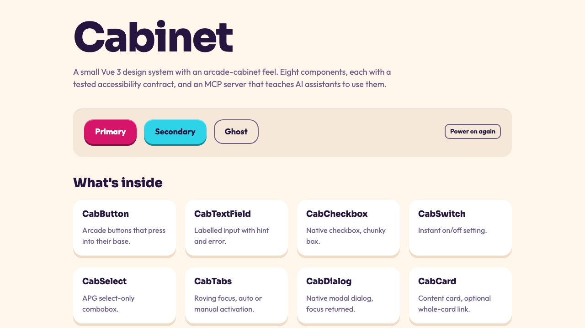
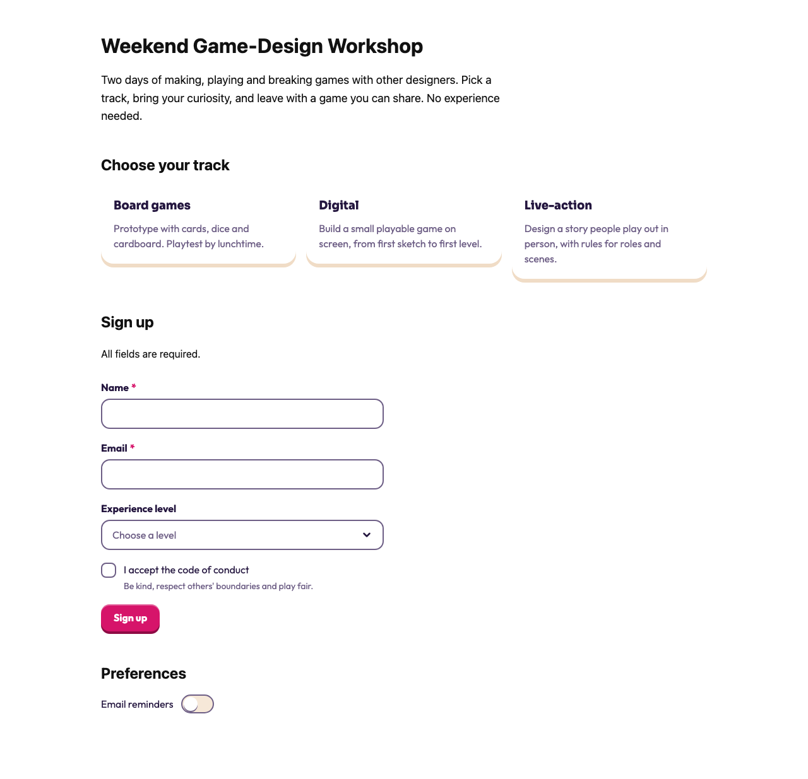
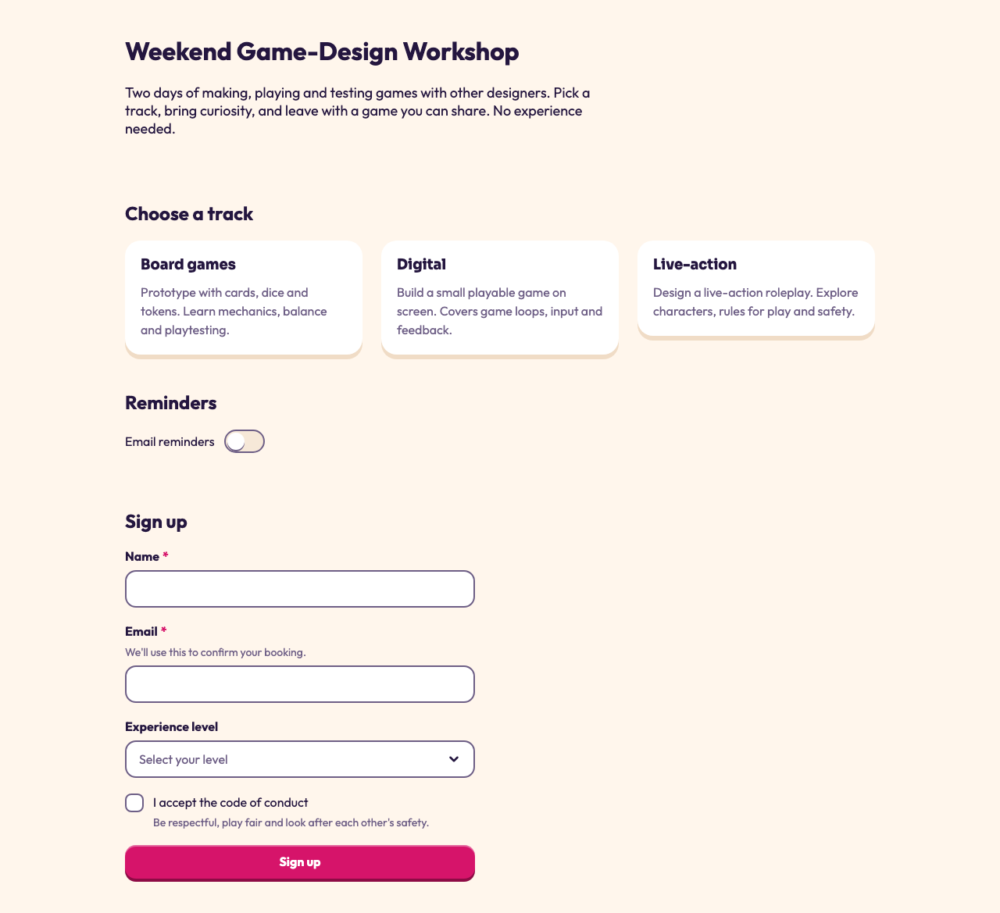

# Cabinet

A small Vue 3 design system with an arcade-cabinet feel: 8 accessible components, Style Dictionary design tokens built to round-trip with Figma variables, Storybook docs, and an **MCP server that teaches AI coding assistants to use the library**. The server's data is generated from the library's own source.

[](https://github.com/eltonbautista/design-system-mcp/actions/workflows/ci.yml)
[](https://www.npmjs.com/package/@eltonbautista/vue)
[](https://www.npmjs.com/package/@eltonbautista/mcp)

**[Storybook docs →](https://eltonbautista.github.io/design-system-mcp/)**



| Package | What it is |
| --- | --- |
| [`@eltonbautista/tokens`](packages/tokens) | Design tokens as CSS custom properties, JS and JSON (Style Dictionary, DTCG). |
| [`@eltonbautista/vue`](packages/vue) | `CabButton`, `CabTextField`, `CabCheckbox`, `CabSwitch`, `CabSelect`, `CabTabs`, `CabDialog`, `CabCard`. |
| [`@eltonbautista/mcp`](packages/mcp) | MCP server: `list_components`, `get_component`, `get_tokens`, `get_usage_example`. |

## Quick start

```sh
npm i @eltonbautista/vue @eltonbautista/tokens
```

```ts
// main.ts
import '@eltonbautista/tokens/tokens.css'
import '@eltonbautista/tokens/fonts.css'
import '@eltonbautista/vue/style.css'
```

```vue
<script setup lang="ts">
import { ref } from 'vue'
import { CabButton, CabTextField } from '@eltonbautista/vue'
const email = ref('')
</script>

<template>
  <CabTextField v-model="email" label="Email" type="email" hint="We only use it to send your ticket." />
  <CabButton>Book a seat</CabButton>
</template>
```

To use the MCP server with Claude Code:

```sh
claude mcp add cabinet -- npx -y @eltonbautista/mcp
```

## Accessibility is the contract

Every component follows a [WAI-ARIA APG](https://www.w3.org/WAI/ARIA/apg/) pattern. Each one ships a `Cab<Name>.docs.md` file that sets out its **pattern, keyboard map, focus behaviour and screen-reader output**. That one file feeds both the Storybook "Accessibility" section and the MCP server.

The claims are tested, not just written down:

- **Real browser tests:** 94 tests run in Chromium (Vitest browser mode with Playwright). They cover keyboard maps, roving focus, the focus trap, focus returning to the trigger (including when the trigger has been removed), and ids staying unique when a component appears more than once.
- **axe:** every example runs through axe-core. For `Select` and `Dialog`, that includes the open state.
- **Storybook:** every story runs as a test with the a11y add-on set to `error`.
- **Colour contrast:** every text and background token pair is checked against WCAG AA in CI.
- **Lint:** `eslint-plugin-vuejs-accessibility` runs on every component. Each inline suppression gives its reason, for example the activedescendant pattern.
- **Motion:** every motion respects `prefers-reduced-motion`. The press distance is a token that drops to `0px`, so feedback becomes colour-only.

A few of the decisions:

- **Select:** a select-only combobox (`aria-activedescendant`, typeahead, no wrap). DOM focus never leaves the combobox.
- **Tabs:** roving tabindex, with automatic or manual activation. It falls back safely when `modelValue` is unknown or points at a disabled tab.
- **Dialog:** a native `<dialog>` opened with `showModal()`, which makes the page behind it inert. Tab wraps explicitly, and focus returns to the trigger only if it's still connected.
- **Card:** an `href` prop gives a stretched title link. The whole card is clickable, with one tab stop and a short link name, instead of an `<a>` wrapped around everything.

## How the MCP server knows the library

```
packages/vue/src/components/Cab*/        ┐
  Cab<Name>.vue        (props, events, slots, JSDoc  → vue-component-meta)
  Cab<Name>.docs.md    (accessibility contract)
  examples/*.vue       (tested usage examples)       ├─ scripts/build-registry.ts ─→ packages/mcp/src/registry.json ─→ MCP tools
packages/tokens/dist/tokens.json (Style Dictionary)  ┘
```

The registry is generated, never hand-written. `pnpm registry:check` fails CI if it's out of date with the source. The release workflow also regenerates it whenever versions are bumped.

## Demo: Claude Code with vs without the MCP server

The setup is the same for every run:
- a fresh Vite app with the **published** packages installed;
- the same prompt and the same model;
- stock Claude Code: `--setting-sources project` loads no personal plugins, skills, hooks or permission rules;
- `--strict-mcp-config` on both sides.

The **only** difference is whether the Cabinet MCP server is connected. Without it, Claude can still read the package's type definitions in `node_modules`, which keeps the comparison fair. Each page is then scored automatically by [`demo/score.ts`](demo/score.ts):

- **In the code:**
  - only library components are used, with no raw controls;
  - every prop and `--cab-*` token exists;
  - no hard-coded colours.
- **In the built page, in a browser:**
  - it builds, and axe finds no issues;
  - clicking anywhere on a track card goes to that track's page, with one tab stop and a short link name;
  - reminders use a `switch`;
  - the code of conduct uses a `checkbox`.

The table below is generated by `pnpm demo:report` from the run files in [`demo/runs`](demo/runs).

<!-- demo:start -->
| Run set | Mode | Trials | Clean on every quality check | Avg time | Avg cost | Avg `node_modules` reads | Avg MCP calls |
|---|---|---|---|---|---|---|---|
| Prompt 1 (names the components), Sonnet | without MCP | 1 | 0 / 1 | 32s | $0.121 | 6 | 0 |
| Prompt 1 (names the components), Sonnet | **with MCP** | 1 | 1 / 1 | 26s | $0.137 | 0 | 15 |
| Prompt 2 (outcomes only), Sonnet | without MCP | 3 | 1 / 3 | 41s | $0.138 | 4.7 | 0 |
| Prompt 2 (outcomes only), Sonnet | **with MCP** | 3 | 3 / 3 | 49s | $0.207 | 2.7 | 14.3 |
| Prompt 2 (outcomes only), Haiku | without MCP | 3 | 3 / 3 | 80s | $0.019 | 10.7 | 0 |
| Prompt 2 (outcomes only), Haiku | **with MCP** | 3 | 3 / 3 | 60s | $0.016 | 0 | 15.3 |
<!-- demo:end -->

- **Prompt 1** ([`PROMPT-v1.md`](demo/PROMPT-v1.md)) names the components to use. The page built without the MCP server missed its `<h1>` (axe `page-has-heading-one`). Everything else was clean on both sides.
- **Prompt 2** ([`PROMPT.md`](demo/PROMPT.md)) only describes outcomes, such as "clicking anywhere on a track's card should take you to that track's page" and "this saves immediately". Choosing the right component is left to the model.

| Without MCP (prompt 2, Sonnet, trial 3) | With MCP (prompt 2, Sonnet, trial 3) |
| --- | --- |
|  |  |

On the left, the invented tokens (`--cab-color-bg`, `--cab-color-text`) resolve to nothing, so the page loses Cabinet's background and heading font. The components themselves still render correctly.

### What this shows (and what it doesn't)

- **Every run made the right component choices.** With or without the MCP server, Claude used `CabCard href` for whole-card links, `CabSwitch` for the setting that saves immediately and `CabCheckbox` for consent, and never used a prop that doesn't exist. Good TypeScript types with "when to use" JSDoc in the published package carry most of that guidance on their own.
- **The MCP server kept the styling on-system.** All 7 runs with the MCP server were clean on every check. Without it, 4 of 7 were. The failures were a missing `<h1>`, hex colours, and invented tokens (`--cab-color-bg`, `--cab-color-text`). The tokens are the part that type files can't describe.
- **Speed and cost depend on the model.** On Haiku, the MCP server made runs about 25% faster and slightly cheaper, with no digging through `node_modules`. On Sonnet with prompt 2, the MCP runs were slower and cost more, because they called the tools 12 to 16 times.
- **The sample is small** (1 to 3 trials per cell), so read this as evidence rather than proof. The runs are reproducible with the commands below.
- **The harness was tested too.** Checking the results turned up five scorer bugs, and each now has a test that failed first. A review also found that the first runs weren't isolated from the operator's own plugins, so every run was redone in isolation. The table shows only the isolated runs.

Run it yourself: `demo/run.sh without 1 v2`, `demo/run.sh with 1 v2`, then `pnpm demo:report`. Set `DEMO_MODEL` to change the model.

## Design

The visual direction is **Arcade Cabinet**, based on the physical machine rather than its screen. The ground is warm cream, with candy accents (pink, cyan, purple and yellow) and glossy buttons that press into a coloured base. Headings use Sora and the interface uses Outfit. Motion is short and subtle, using a single easing curve with no bounce. The Storybook welcome page has one GSAP "power-on" moment, which doesn't run under reduced motion.

The tokens are DTCG JSON in `packages/tokens/src`, with Cabinet's own names (no SDS naming), built by Style Dictionary. They're designed to round-trip with Figma variables through an import/export plugin. The token structure takes its cue from Figma's Simple Design System kit.

## Development

```sh
pnpm install
pnpm --filter @eltonbautista/tokens build
pnpm test              # tokens, components (browser), Storybook stories, MCP, registry, demo scorer
pnpm lint && pnpm typecheck
pnpm --filter docs storybook
pnpm registry          # regenerate the MCP registry after changing a component
```

| Concern | Tooling |
| --- | --- |
| Tokens | Style Dictionary 5, DTCG JSON, WCAG contrast tests |
| Components | Vue 3.5 (`useId`), TypeScript, Vite library mode, `unplugin-dts` |
| Tests | Vitest browser mode (Playwright Chromium), axe-core, `vitest-browser-vue` |
| Docs | Storybook 10 (`addon-docs`, `addon-a11y`, `addon-vitest`), GSAP on the welcome page |
| MCP | `@modelcontextprotocol/sdk`, zod, registry generated with `vue-component-meta` |
| Release | Changesets, GitHub Actions (CI, Pages, npm with provenance) |

MIT © Elton Bautista
